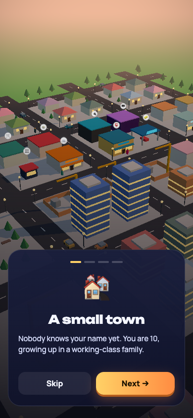
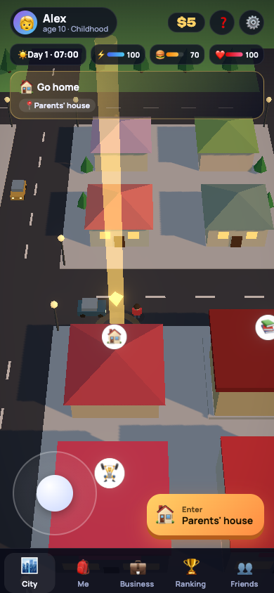
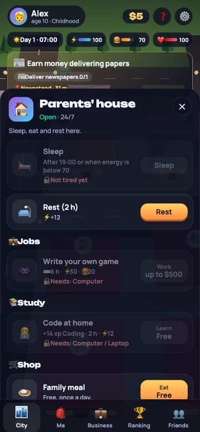
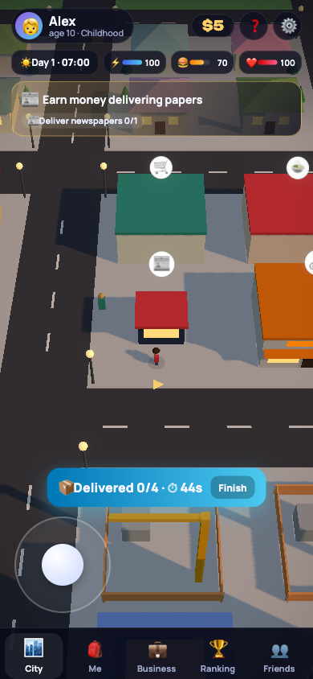

# 🚀 Zero to Mars (Noldan Marsgacha)

A 3D life simulator that runs as a **Telegram Mini App**. You start as a 10-year-old kid with $0 and a dream of reaching Mars. Deliver newspapers, wash cars, learn to code, buy your first computer, move abroad, found startups, launch rockets, become a billionaire and finally build a city on Mars.

The hero's path is inspired by Elon Musk's biography, but the hero and every company in the game are fictional: CityMap, PayNova, Orbitra, Voltra, SunGrid, BoreCo, NeuroBridge.

The game is available in **Uzbek, Russian and English**; the language is detected from Telegram automatically.

## Screenshots

|  |  |  |  |
|:--:|:--:|:--:|:--:|
|  |  |  |  |
| A cinematic intro opens the story | Walk the 3D city with the joystick, or tap a building and the hero walks there | Every building has its own jobs, study options and shop, gated by age, skills and items | Jobs are timed mini-games, not tap-to-earn — your score sets the wage |

## Features

| | |
|---|---|
| **3D city** | 5×5 city blocks with roads, traffic, pedestrians and 20 enterable buildings. Walk with a joystick or the keyboard, or tap a building and the hero walks there by himself (A* pathfinding). |
| **Real jobs, no tapping** | There is no tap-to-earn. Every job is a mini-game and your score decides the wage: delivery routes across the city, cashier (count the exact change), PC repair (memory sequence), coding (assemble the program in the right order), car wash and boiler cleaning (scrub with your finger). |
| **Story mode** | A cinematic intro, then a 34-quest campaign across 7 life chapters: childhood → abroad → CityMap → PayNova → the big bet → empire → Mars. |
| **Life simulation** | In-game clock with day and night, energy, food and health. Every 3 days you age one year. From the second chapter on you pay rent every night. |
| **Extremely hard** | Low wages, high prices, jobs gated by age, items and skills, buildings with opening hours. Collapse from hunger and the hospital bill becomes debt that grows 5% every night. |
| **Persistent tutorial** | Current quest with live progress always on screen, a beacon on the target building, a direction arrow at the hero's feet, contextual tips, warnings and a help screen. |
| **Businesses** | Unlock in the CityMap chapter (age 24) and earn in real time, even while you are away (up to 3 hours). |
| **Social** | Global and friends leaderboards, referral bonuses, daily rewards. |
| **Graphics settings** | Low / Medium / High / Ultra presets plus individual shadows, glow, resolution, view distance, traffic density, FPS meter and auto-optimization. |

## Tech stack

- **Client:** React 19, Three.js via React Three Fiber, `@react-three/drei`, `@react-three/postprocessing`, Zustand, Vite.
- **Server:** Node.js 24 (runs TypeScript directly via type stripping), Fastify 5, built-in `node:sqlite`, grammY for the Telegram bot.
- **Shared:** one deterministic game engine used by both the client (instant prediction) and the server (authoritative replay).
- **Deploy:** Docker + Caddy (automatic HTTPS).

### Anti-cheat

The client applies every action instantly and queues it for the server. The server replays the actions with the same engine and clamps their timestamps to its own clock, so a client cannot fast-forward time, finish a job faster than its minimum real duration or fake money. Telegram `initData` is validated with HMAC.

### Performance

The city is generated procedurally and merged into a few meshes per block (one per material), so a frame takes about 40 draw calls. Cars and pedestrians are drawn with instanced meshes. Blocks outside the camera are culled.

## Project structure

```
shared/                 game engine + content (used by client and server)
  src/engine.ts         deterministic rules: time, needs, jobs, quests, economy
  src/content/*.ts      eras, buildings, jobs, shop, quests, events (3 languages)
  test/                 engine tests and a scripted player bot
client/                 Vite + React + React Three Fiber
  src/scene/            3D city, hero, traffic, markers, rocket
  src/minigames/        the four job mini-games
  src/ui/               HUD, building panel, menus, story and dialogs
  src/store.ts          game state, sync with the server, tutorial
server/                 Fastify API, SQLite, Telegram bot
scripts/balance.ts      economy balance simulation
```

## Getting started

Requires **Node.js 24** or newer.

```bash
npm install
```

Run the API and bot in dev mode (outside Telegram a dev account is used):

```bash
npm run dev:server
```

In a second terminal, run the 3D client at http://localhost:5173:

```bash
npm run dev
```

Without a server the game falls back to offline mode and keeps the save in the browser.

## Testing

```bash
npm test
```

```bash
npm run typecheck
```

```bash
npm run balance
```

`npm run balance` lets a scripted bot play the story and prints how many in-game days and hours of active play each life chapter takes. With the current tuning, reaching Mars takes about 30 hours of active play. Difficulty is tuned in `shared/src/content/city.ts` (wages and prices), `shared/src/content/quests.ts` and the constants in `shared/src/engine.ts`.

## Deploying to Telegram

A step-by-step guide (BotFather, domain, Docker, HTTPS, backups) is in **[DEPLOY.md](DEPLOY.md)** (written in Uzbek).

Short version:

```bash
cp .env.example .env
```

```bash
docker compose up -d --build
```

Fill in `BOT_TOKEN`, `BOT_USERNAME`, `DOMAIN` and `WEBAPP_URL` in `.env` first. Every variable is documented in [.env.example](.env.example).

## License

[MIT](LICENSE) © 2026 Viltrumlik
